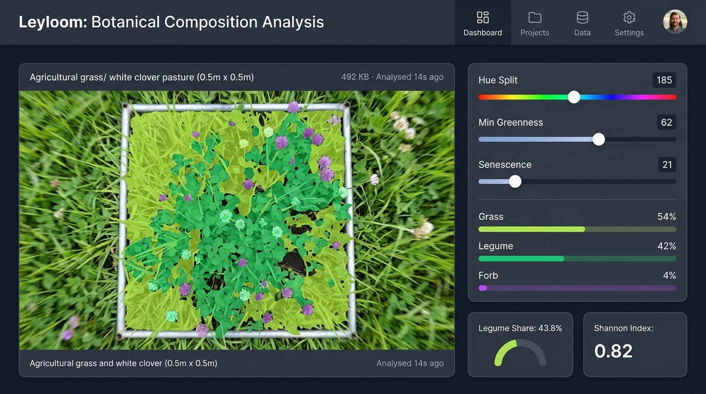
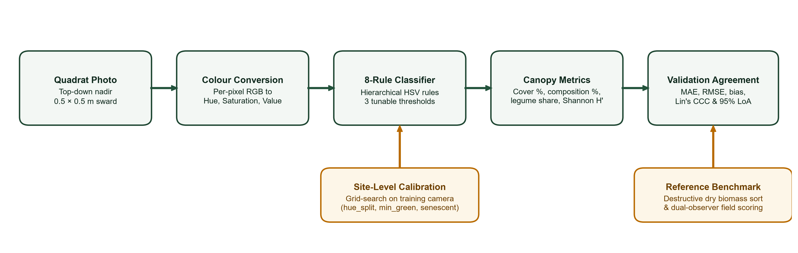
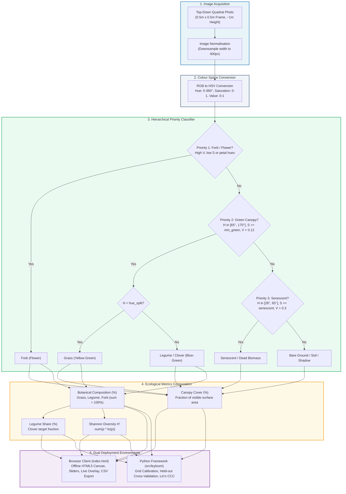
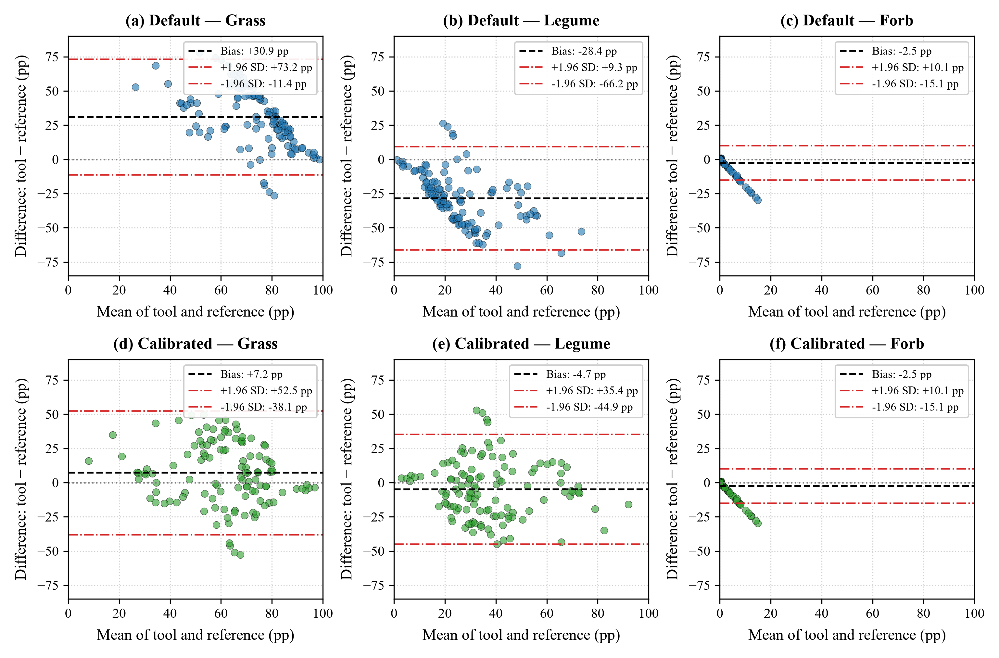
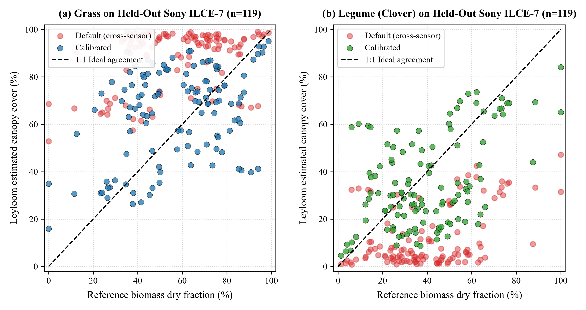
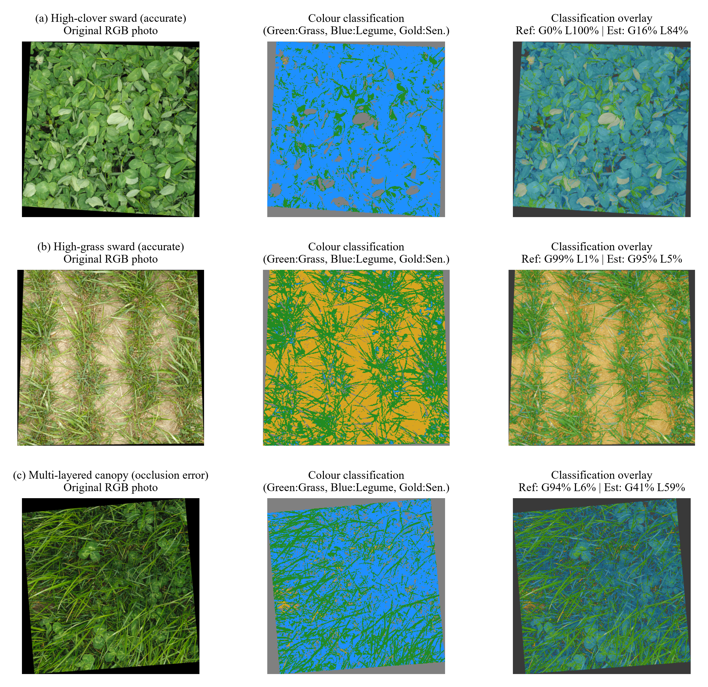

# Leyloom: colour-based estimation of functional-group composition in grass-legume leys from quadrat photographs, with an open validation framework

**Arpan Ghosh**  
*Independent Researcher (Agribusiness & Applied AI Systems), Birbhum, West Bengal, India*  
**Contact:** `arpanghosh984@gmail.com` | +91 77971 30249 | [GitHub Profile](https://github.com/Arpanthebaap)  
Version 0.3.0 · MIT licence  
[](https://doi.org/10.5281/zenodo.23357579)
[](https://github.com/Arpanthebaap/leyloom/actions/workflows/tests.yml)
[](https://github.com/Arpanthebaap/leyloom/actions/workflows/pages.yml)  
**Live Web Tool:** https://arpanthebaap.github.io/leyloom/ · **Repository:** https://github.com/Arpanthebaap/leyloom

---



> **Status.** Evaluated on the public GrassClover benchmark dataset (n = 261 biomass-labelled crops across two acquisition systems). Uncalibrated default thresholds exhibit high cross-camera error (MAE ~30–32 percentage points); calibrating three colour thresholds on training images cuts MAE to ~17–19 percentage points and substantially reduces bias on held-out test cameras (see Section 5). Field validation on local farm swards with human-observer benchmarks is pending.

---

## Abstract
Species-rich and grass-legume leys are central to ruminant forage systems, and their botanical composition governs yield, quality, and persistence. Measuring composition by hand-sorting cut samples is slow and destructive, while visual cover estimates vary between observers, limiting how many plots, dates, and farms a trial can cover. Leyloom is an open, offline tool that classifies the pixels of a top-down quadrat photograph into grass, legume, forb, senescent material, and bare ground using transparent colour rules, and reports cover, legume share, and a functional-group Shannon index ($H'$). We pair the tool with a validation framework that compares its output with reference composition using mean absolute error, bias, Lin's concordance correlation coefficient, and Bland-Altman limits of agreement, calibrates thresholds on training sites only, and reports error on held-out sites. The framework is evaluated here against the public GrassClover biomass dataset and provides an inspectable baseline for comparing learned segmentation models.

---

## System Architecture



The complete processing and evaluation workflow across both the offline client-side web application and the Python evaluation framework is structured as follows:



---

## 1. Introduction
Perennial leys with several grass, legume, and forb species can raise productivity, persistence, and resilience, but studying them at scale requires composition data from many plots, seasons, and farms. Botanical separation is accurate but laborious, and visual estimates depend on the observer. Image-based methods can help, yet the strongest published work relies on deep networks trained on large, specialised image sets, which demand data, compute, and expertise that many field groups lack.

We ask a practical question: **how far can a transparent, calibratable colour baseline go, and where does it fail?** A baseline with known failure modes is useful in itself, as a screening tool in the field and as the reference any learned model must beat.

**Research questions**
- **RQ1.** How well does colour-rule cover agree with reference composition (hand-sorted biomass fractions or expert visual cover) for grass, legume, and forb?
- **RQ2.** How much does per-site calibration of three thresholds improve agreement, and does it transfer to unseen sites and camera hardware?
- **RQ3.** Under which conditions (illumination, growth stage, flowering, senescence, soil colour) does the baseline fail?
- **RQ4.** Is the baseline's error comparable to the disagreement between two human observers?

---

## 2. Related Work
The GrassClover dataset provides grass-clover canopy images with biomass-labelled crops, synthetic images with pixel labels, and 31,600 unlabeled images, collected with three acquisition systems at 4 to 8 px/mm and across field and plot trials (Skovsen et al., 2019). The same Aarhus group used convolutional neural networks for species distribution mapping in crop mixtures (Skovsen et al., 2021) and runs the CloverSense and SmartGrass project on clover-grass botanical composition for targeted fertilisation. Leyloom does not compete with that work. It supplies a lightweight, open baseline and an evaluation recipe that can be run against such data, providing an accessible route for groups without deep-learning infrastructure.

---

## 3. How the Tool Works

### 3.1 Colour-Space Transformation (RGB to HSV)
Raw digital photographs store pixels in RGB coordinates, where colour chromaticity is entangled with illumination intensity and shading. Each pixel $(R, G, B) \in [0, 255]^3$ is first normalised to $[0, 1]$ and converted to cylindrical HSV coordinates:
- **Hue ($H \in [0^\circ, 360^\circ]$):** The pure color angle (red at $0^\circ$, yellow at $60^\circ$, green at $120^\circ$, cyan at $180^\circ$, blue at $240^\circ$, magenta at $300^\circ$).
- **Saturation ($S \in [0, 1]$):** The purity or vibrancy of the color relative to neutral gray.
- **Value ($V \in [0, 1]$):** The lightness/brightness of the pixel.

Decoupling chromaticity from brightness enables rules that remain consistent across bright sunlit canopy patches and mild shadows.

### 3.2 Hierarchical Decision Waterfall
Each pixel is evaluated against a fixed priority waterfall. The first rule that matches determines the classification:

| Priority | Class | Biological Target | Exact Rule Criteria |
|---|---|---|---|
| **1** | **Forb (flowers)** | White clover inflorescences, chicory, knapweed, dandelions | $(V > 0.82 \text{ and } S < 0.14)$<br/>$\text{or } (S > 0.4, V > 0.5 \text{ and } (H \in [270^\circ, 345^\circ] \cup H \le 12^\circ))$<br/>$\text{or } (S > 0.7, V > 0.75 \text{ and } H \in [46^\circ, 64^\circ])$ |
| **2** | **Grass / Legume** | Photosynthetically active green foliage | $H \in [65^\circ, 170^\circ]$, $S \ge \text{min\_green}$, $V > 0.12$<br/>$\rightarrow$ **Grass** if $H < \text{hue\_split}$<br/>$\rightarrow$ **Legume** if $H \ge \text{hue\_split}$ |
| **3** | **Senescent** | Dead leaves, straw, dry plant litter | $H \in [28^\circ, 65^\circ]$, $S \ge \text{senescent}$, $V > 0.30$ |
| **4** | **Bare Ground** | Dark soil, rocks, deep canopy voids | All other pixels |

**Default parameters:**
- `hue_split = 98.0` (separates yellow-green grasses from blue-green clovers)
- `min_green = 0.22` (minimum saturation to qualify as active green vegetative leaf)
- `senescent = 0.30` (saturation threshold distinguishing dry brown matter from soil)

Both implementations—JavaScript in `index.html` and Python in `src/leyloom/classify.py`—share identical mathematical rules, confirmed by continuous automated parity tests.

### 3.3 Ecological Outputs & Formulas
1. **Canopy Cover ($C_k$):** The percentage of total image pixels assigned to class $k \in \{\text{grass}, \text{legume}, \text{forb}, \text{senescent}, \text{bare}\}$:
   $$C_k = 100 \times \frac{N_k}{N_{\text{total}}}$$
2. **Botanical Composition ($P_k$):** Normalized proportion among the three functional plant groups, directly comparable to dry biomass separation fractions:
   $$P_k = 100 \times \frac{C_k}{C_{\text{grass}} + C_{\text{legume}} + C_{\text{forb}}}$$
3. **Legume Share ($L$):** Proportion of the botanical fraction composed of nitrogen-fixing legumes:
   $$L = \frac{P_{\text{legume}}}{P_{\text{grass}} + P_{\text{legume}} + P_{\text{forb}}} \times 100$$
4. **Shannon Diversity Index ($H'$):** Evenness across the three functional groups:
   $$H' = -\sum_{k \in \{\text{grass}, \text{legume}, \text{forb}\}} p_k \ln(p_k) \quad \text{where } p_k = \frac{P_k}{100}$$
   Maximum diversity for three equal groups is $\ln(3) \approx 1.099$.

---

## 4. Setup and Quickstart Guide

### 4.1 Running the Browser App (No Installation Needed)
The web application runs 100% locally in any modern browser without servers, logins, or external dependencies:
1. **Live online:** Open [https://arpanthebaap.github.io/leyloom/](https://arpanthebaap.github.io/leyloom/).
2. **Offline locally:** Clone or download this repository, then double-click `index.html` in your file explorer.
3. **Try the synthetic demo:** Click **"Try a synthetic demo"** to generate an artificial grass-clover canopy with random flower and senescent patches, and observe the live segmentation overlay and calculated percentages.
4. **Analyse your own photo:** Click **"Choose quadrat photo"**, select a top-down quadrat picture, and adjust the **Hue Split**, **Min Greenness**, or **Senescence** sliders to match your local lighting conditions.
5. **Log and export:** Enter your plot ID and click **"Add to plot log"**, then **"Export CSV"** to save your field data.

### 4.2 Python Framework Installation
To use the Python package for batch processing, automated threshold calibration, or running the benchmark:

```bash
# Clone the repository
git clone https://github.com/Arpanthebaap/leyloom.git
cd leyloom

# Create and activate a virtual environment
python -m venv .venv

# On Windows (PowerShell):
.\.venv\Scripts\Activate.ps1
# On Linux / macOS:
source .venv/bin/activate

# Install in editable mode with development dependencies
pip install -e ".[dev]"
```

### 4.3 Running the Test Suite
The repository includes unit tests for classification rules, metric identities, calibration recovery, and cross-language parity:

```bash
# Run Python core unit tests
pytest -v

# Run Node.js JavaScript/Python cross-language parity test
node tests/parity.test.mjs
```

### 4.4 Reproducing the GrassClover Benchmark
To reproduce the evaluation reported in Section 5:

```bash
# 1. Download the biomass dataset into data/images/ (git-ignored)
# 2. Generate data/reference.csv with camera-system site mappings:
python benchmark/prepare_grassclover.py

# 3. Execute calibration on Nikon D810A and test on held-out Sony ILCE-7:
python benchmark/run_benchmark.py --images data/images --reference data/reference.csv \
    --calibrate --test-sites ILCE-7 --out results/
```

Results and chosen parameters will be saved to `results/metrics.csv` and `results/run.json`.

---

## 5. Benchmark Results

Evaluated on the **GrassClover biomass benchmark dataset** ($n = 261$ images; Skovsen et al., 2019). The benchmark was calibrated on the Nikon D810A acquisition cohort ($n = 142$ images) and tested strictly on the held-out Sony ILCE-7 camera system ($n = 119$ images) to measure cross-hardware generalization.

### 5.1 Benchmark Metrics on Held-out System (Sony ILCE-7, n = 119)

| Thresholds | Group | n | MAE (%) | RMSE (%) | Bias (%) | Lin's CCC | 95% LoA Lower | 95% LoA Upper |
|:---|:---|---:|---:|---:|---:|---:|---:|---:|
| **Default** | grass | 119 | 32.45 | 37.66 | +30.93 | 0.110 | -11.36 | +73.21 |
| **Default** | legume | 119 | 29.94 | 34.30 | -28.43 | 0.156 | -66.19 | +9.34 |
| **Default** | forb | 119 | 2.75 | 6.87 | -2.50 | -0.004 | -15.09 | +10.08 |
| **Calibrated** | grass | 119 | **19.42** | 24.11 | **+7.22** | **0.360** | -38.06 | +52.50 |
| **Calibrated** | legume | 119 | **16.87** | 20.93 | **-4.72** | **0.472** | -44.86 | +35.42 |
| **Calibrated** | forb | 119 | 2.75 | 6.87 | -2.50 | -0.004 | -15.08 | +10.09 |

*Calibrated parameters chosen on Nikon training images:* `hue_split = 90`, `min_green = 0.32`, `senescent = 0.20` (stored in `results/run.json`).

### 5.2 Statistical Agreement Analysis (Bland–Altman Plots)


*Figure 2. Bland–Altman agreement plots comparing Leyloom against reference biomass composition on held-out test images (Sony ILCE-7, n = 119). Top row (a–c): uncalibrated default thresholds; bottom row (d–f): calibrated thresholds (hue_split = 90°, min_green = 0.32, senescent = 0.20, fitted on Nikon D810A). Dashed black lines indicate mean bias; red dash-dotted lines denote 95% limits of agreement (±1.96 SD).*

### 5.3 Predicted Cover vs. Reference Biomass Fractions


*Figure 3. Scatter plots of predicted canopy cover versus reference biomass dry fraction for grass (a) and legume (b) on the held-out test set (n = 119). Red circular markers display predictions under uncalibrated default thresholds; coloured markers show predictions following site-level optical calibration. Dashed diagonal line indicates ideal 1:1 concordance.*

### 5.4 Qualitative Sward Classification & Failure Case Overlays


*Figure 4. Qualitative pixel classification maps and overlays across representative swards. Left column: original nadir RGB images; middle column: Leyloom HSV pixel segmentation (green: grass, blue: legume, gold: senescent, grey: bare ground); right column: alpha-blended overlay showing reference dry biomass percentages versus Leyloom estimated canopy cover. Rows illustrate (a) an accurate high-clover canopy, (b) an accurate high-grass canopy, and (c) a dense multi-layered sward exhibiting vertical occlusion.*

### 5.5 What the Results Show (and Where the Tool Fails)
1. **Severe uncalibrated cross-camera bias:** With default thresholds, the model produces a systematic bias of +30.9% on grass and -28.4% on clover. Differences in camera colour rendering and default white-balance shift pixels across the hue boundary.
2. **Calibration substantially reduces error and bias:** Tuning the three thresholds on the Nikon training images (`hue_split`: 90 vs 98 default; `min_green`: 0.32 vs 0.22 default) cuts MAE nearly in half (from 32.5% to 19.4% for grass, and 29.9% to 16.9% for legume) and drops bias to +7.2% and -4.7%. Concordance correlation (CCC) rises from ~0.11-0.16 to 0.36-0.47.
3. **Where the tool is poor:**
   - Even after calibration, an error of **17-19 percentage points** is substantial. In commercial or agronomic trials where clover target fractions are 20-30%, a ±18% error margin is too wide for precise nitrogen budgeting. This demonstrates the fundamental ceiling of colour-only rules: 2D canopy surface cover does not account for multi-layer biomass occlusion or shaded clover leaves under grass canopy.
   - **Forbs (weeds) cannot be resolved without flowers:** Forb CCC is -0.004. Broadleaf vegetative weeds share the same green hues as the forage crop and are misclassified as grass or clover unless distinctive colored petals are present.
   - **Conclusion:** Leyloom provides a transparent, zero-compute baseline that can be calibrated for exploratory field screening, but it cannot replace deep semantic segmentation networks that exploit spatial texture and leaf shape. Any machine learning model developed for this task must beat this 17-19% MAE baseline.

---

## 6. Limitations (Known and Expected)
- **Functional groups, not species:** Forbs without conspicuous flowers are counted as grass or legume.
- **Canopy occlusion:** Pixel cover of the visible surface is not destructive biomass; dense upper leaves occlude lower layers.
- **Illumination sensitivity:** Colour varies with sun angle, cloud cover, wet leaves, and camera white balance. Thresholds require calibration per camera setup.
- **Known failure mode:** Mid-brown soil (e.g., RGB 100, 80, 60) falls near the senescent rule boundary and can be classified as dead biomass; documented by unit tests.
- **Spectral overlap:** Dark-green clover leaves and shaded perennial ryegrass can overlap in hue angle.

---

## 7. Reproducibility
All thresholds are explicit parameters; both implementations share one rule table; splits are strictly by site/camera system; the benchmark writes `metrics.csv` and the chosen thresholds to `results/run.json`.

---

## 8. Roadmap
1. [x] Benchmark on public GrassClover dataset and report metrics honestly.
2. [ ] Collect paired quadrat photographs on partner trial leys with dual-observer visual estimates.
3. [ ] Add a reference-card automatic white-balance and color-normalization step.
4. [ ] Compare the transparent colour baseline against a lightweight convolutional segmentation network (e.g. MobileNet-UNet).
5. [ ] Add temporal tracking of functional group persistence across grazing cycles.

---

## 9. Ethics, Data and AI-Use Statement
No personal data are processed. Photographs from farms require the landowner's consent. Datasets keep their original licences and citations. *Software and documentation were drafted with AI assistance and reviewed, run, and edited by the author, who is responsible for the content.* Please review and amend this statement if your personal workflow differs.

---

## References
- Skovsen, S., Dyrmann, M., Mortensen, A. K., Laursen, M. S., Gislum, R., Eriksen, J., Farkhani, S., Karstoft, H., Jorgensen, R. N. (2019). The GrassClover Image Dataset for Semantic and Hierarchical Species Understanding in Agriculture. *CVPR Workshops*, 2676-2684. doi:10.1109/CVPRW.2019.00325
- Skovsen, S. K., Laursen, M. S., Kristensen, R. K., Rasmussen, J., Dyrmann, M., Eriksen, J., Gislum, R., Jorgensen, R. N., Karstoft, H. (2021). Robust Species Distribution Mapping of Crop Mixtures Using Color Images and Convolutional Neural Networks. *Sensors*, 21(1), 175. doi:10.3390/s21010175
- Lin, L. I.-K. (1989). A concordance correlation coefficient to evaluate reproducibility. *Biometrics*, 45(1), 255-268.
- Bland, J. M., Altman, D. G. (1986). Statistical methods for assessing agreement between two methods of clinical measurement. *The Lancet*, 327(8476), 307-310.

---

## Citing
See `CITATION.cff`. Cite as:
```bibtex
@software{ghosh2026leyloom,
  author       = {Ghosh, Arpan},
  title        = {Leyloom: colour-based estimation of functional-group composition in grass-legume leys from quadrat photographs},
  year         = {2026},
  version      = {0.3.0},
  doi          = {10.5281/zenodo.23357579},
  url          = {https://github.com/Arpanthebaap/leyloom}
}
```

## Licence
MIT License. Datasets and external papers cited here retain their original licenses.
